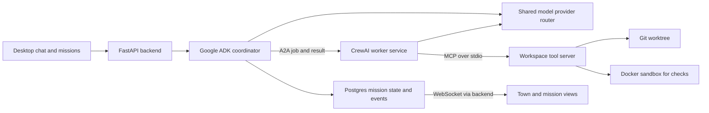

# Learn agentic AI through H.E.X Mind

H.E.X Mind is a desktop coding workspace that can answer questions about a repository and run software-building missions. This guide follows the course syllabus and uses HEX to show what each idea looks like in code. Start with the example mission, then follow the source links for the concepts you want to explain or demonstrate. The [project README](../README.md) covers installation and screenshots, and the [course requirements matrix](../PRD.md#16-course-requirements-coverage) tracks implementation and evidence.

- [Start with the model and example mission](#1-from-a-language-model-to-an-agent)
- [Learn CrewAI, ADK, and callbacks](#3-crewai-google-adk-and-their-responsibilities)
- [Trace MCP, A2A, state, and retrieval](#5-tool-calling-mcp-and-a2a)
- [Study workflow patterns, safety, and observability](#7-reasoning-prompting-and-workflow-patterns)
- [Understand E1-E6 and practice for the capstone](#10-evaluation-and-course-experiments)

## 1. From a language model to an agent

| Concept | What it means | Where to see it in HEX |
| --- | --- | --- |
| Intelligent agent | A system that observes an environment and takes actions toward a goal. A thermostat is a simple agent. A coding agent can observe files and test output, then choose a tool or propose an edit. | A CrewAI worker receives a feature and can inspect or edit its assigned worktree. [Agent construction](../apps/backend/app/agents/build.py) |
| Transformer | A neural network architecture that uses attention to relate tokens to one another. A token is a unit of text, often a word fragment. Attention helps the model use earlier context when processing the current token. | HEX consumes pretrained models through provider adapters. Their underlying architecture belongs to the model provider. [Original Transformer paper](https://arxiv.org/abs/1706.03762) |
| Large language model (LLM) | A model trained on large amounts of text and other data. A generative LLM produces a response token by token from the context it receives. It can also emit a structured request to use a tool. | ADK's `HexAdkLlm` and CrewAI's `HexLLM` adapt both frameworks to the same provider layer. [ADK adapter](../apps/backend/app/agents/adk_llm.py), [CrewAI adapter](../apps/backend/app/agents/llm.py) |
| Agent runtime | The application code that gives a model a goal, tools, state, and stopping conditions. A typical cycle is observe → decide → act → observe the result → stop or repeat. | Python owns the tool execution, retry limits, checks, and mission state. A model can propose what to do within that runtime. [Mission runner](../apps/backend/app/missions/runner.py) |
| Single-agent system | One agent owns the task. This minimizes handoffs and makes a useful baseline. | E1's single condition assigns each feature to the same builder persona and removes milestone validators. The benchmark harness still starts and measures the mission. [E1 pattern definitions](../apps/backend/app/evaluation/experiments.py) |
| Multi-agent system | Several agents divide responsibility. A coordinator can assign work, specialists can build, and a separate agent can review. Handoffs, additional model calls, and conflicting edits become design costs. | A PM scopes a mission, the runner assigns features, and persona workers and configured validators handle their stages. [Mission scoping](../apps/backend/app/missions/scoping.py), [mission runner](../apps/backend/app/missions/runner.py) |

In HEX, a **persona** is a reusable role definition with instructions and skills. A **runtime agent** is the object executing that role on a specific job. A **provider** gives access to a model, while a **model assignment** selects which connection and model a role should use. Two personas can use the same model and still have different responsibilities and tool access. [Personas](../apps/backend/app/agents/persona.py), [model assignments](../apps/backend/app/providers/assignments.py)

If the course uses **PEAS** to describe an agent, apply it to a HEX worker. **Performance** means satisfying acceptance criteria within time and cost limits. **Environment** is the assigned repository worktree and execution sandbox. **Actuators** include permitted file edits and check invocations. **Sensors** include the feature brief, file contents, diffs, and check results. [Mission execution model](../PRD.md#8-mission-execution-model), [evaluation metrics](../PRD.md#154-metrics)

## 2. Follow one mission end to end

Imagine asking HEX to “build a small text toolkit with word counting, slug generation, and a summary.” This is a teaching example based on the Text Toolkit benchmark. The same application also has a lighter Ask path for questions such as “Where does this repository calculate word count?” [Text Toolkit specification](../apps/backend/app/evaluation/mission_benchmark/apps/text-toolkit/app.yaml), [conversation entry point](../apps/backend/app/orchestration/conversation.py)

1. **Interpret the user request.** In Agent Chat, Ask, Edit, and Auto are different starting points. In Auto, the router predicts request type and complexity, and application policy determines the next action. A question can go through the answer path using repository context. For the full build example, create a mission and give the PM the goal. [Conversation agent](../apps/backend/app/orchestration/conversation.py)
2. **Scope and plan.** The PM can ask for missing requirements and produce a structured plan. The plan records milestones, features, assigned personas, and acceptance criteria. An example criterion is “the slug generator lowercases a label and separates words with hyphens.” [Scoping](../apps/backend/app/missions/scoping.py), [mission models](../apps/backend/app/missions/models.py)
3. **Prepare and delegate.** The ADK-driven coordinator manages mission execution. It sends a typed job to the CrewAI service over A2A. The builder receives its feature, expected output, and relevant context. Git worktrees give the run its own working copy. [Mission runner](../apps/backend/app/missions/runner.py), [A2A contract](../apps/backend/app/a2a/protocol.py)
4. **Act with tools.** A worker may list files, inspect source, load a skill, edit a file, or invoke a named check. Its model can request the next action after seeing a tool result. MCP provides the workspace tools, and the sandbox handles named project checks. [CrewAI-to-MCP bridge](../apps/backend/app/agents/mcp_bridge.py), [workspace tools](../apps/backend/app/mcp_server/__main__.py)
5. **Verify and hand off.** The runner collects changes and check evidence, records handoffs, and runs the configured review or milestone validation. An eligible failure can feed a bounded repair. Successful work can be checkpointed and later applied through the app. [Validation](../apps/backend/app/missions/validators.py), [execution and repair](../apps/backend/app/missions/runner.py), [applying results](../apps/backend/app/missions/apply.py)
6. **Observe the work.** The app stores typed mission events and streams them to the desktop. Town turns events into activity on the map and can replay recorded work. Open Town independently for the built-in sample, or select a mission for its activity. Movement and animations run in the renderer. [Events API](../apps/backend/app/api/missions.py), [Town screen](../apps/desktop/src/renderer/src/features/missions/town/TownScreen.tsx), [Town screenshot](images/town-overview.webp)

This is the main mission path. The desktop interface takes requests and displays evidence, ADK coordinates decisions and stages, CrewAI executes specialist jobs, and Town renders the event stream as a live or replayable map. [Repository architecture](../README.md#architecture)

## 3. CrewAI, Google ADK, and their responsibilities

### CrewAI runs the worker

- An **Agent** brings a role, goal, backstory or instructions, a model, and a tool list. A **Task** describes the job and expected output. A **Crew** groups agents and tasks with a process that governs execution. In HEX, `build_agent` creates a CrewAI agent from a persona, and `run_agent` creates a one-agent, one-task crew and starts it with `kickoff_async`. The mission has multiple agents because ADK coordinates multiple worker assignments. [CrewAI crews](https://docs.crewai.com/en/concepts/crews), [build_agent](../apps/backend/app/agents/build.py), [run_agent](../apps/backend/app/agents/roles.py)
- **CrewAI Flows** are framework workflows with state and hooks such as `@start`, `@listen`, and `@router`. A Flow can trigger a crew, branch on a result, and pass state to the next step. This is a syllabus feature. HEX implements mission-level scheduling and state transitions with ADK and application code. CrewAI handles the worker kickoff, with CrewAI's built-in memory switched off for those runs. [CrewAI Flows](https://docs.crewai.com/en/concepts/flows), [CrewAI worker lifecycle](../apps/backend/app/agents/roles.py), [mission lifecycle](../apps/backend/app/missions/lifecycle.py)

### Google ADK coordinates the application

- **ADK** means Agent Development Kit. A **Runner** executes an agent invocation with a session and emits events. An **LlmAgent** uses a model for its next response or action. A custom **BaseAgent** can run normal Python logic such as scheduling work or invoking a remote agent. HEX's PM scoping and conversation router use `LlmAgent`. The current mission runner executes through a custom `RunStep` ADK agent. [ADK runtime](https://adk.dev/runtime/), [ADK invocation helper](../apps/backend/app/orchestration/adk.py), [conversation routing](../apps/backend/app/orchestration/conversation.py), [mission entry point](../apps/backend/app/missions/runner.py)
- A **SequentialAgent** invokes its children in order. A **LoopAgent** repeats children until a stopping condition or iteration cap. The editor-oriented run workflow uses `SequentialAgent` for prepare → plan → execute → finalize, and `LoopAgent` for its code → review → decide cycle. The mission path has its own scheduler and checkpoint logic. [Editor workflow](../apps/backend/app/orchestration/run.py), [mission runner](../apps/backend/app/missions/runner.py)

## 4. Before-model, after-model, and other callbacks

A **callback** is a function the framework calls at a defined point in a run. A before-model callback can inspect or change an outgoing request. An after-model callback sees the returned response and may replace it. An agent invocation can make several model calls, so model callbacks can fire several times while the agent's start and finish bracket the invocation. A tool has its own execution hooks. [ADK callback reference](https://adk.dev/callbacks/types-of-callbacks/)

| Callback | When it runs | What HEX does with it |
| --- | --- | --- |
| `before_agent_callback` | Before an ADK agent runs | Starts timing, initializes tracking for schema-enabled agents, and records an agent-started event. |
| `before_model_callback` | After ADK builds a model request and before it sends the request | Telemetry records message and tool counts. For the chat answer agent, `user_message_from_state("context_text")` replaces the request's conversation contents with a prepared user message from session state. That lets HEX control which context the answer sees. |
| `after_model_callback` | When a model turn returns | Telemetry records provider, model, tokens, latency, and requested tool names when available. Selected schema-based agents also run `schema_guard` to validate and normalize the final response. |
| `on_model_error_callback` | When a model call raises an error | Telemetry records the error. Schema-based agents wired with `model_error_fallback` can return a valid fallback payload marked as a fallback. |
| `before_tool_callback`, `after_tool_callback` | Around a tool executed by an ADK `LlmAgent` | Telemetry records the tool and argument names before execution and a clipped result afterward. Actual permission checks live in the tool and sandbox layers. |
| `on_tool_error_callback` | When an ADK tool raises an error | Records the tool error. CrewAI worker tools have their own instrumentation through the bridge. |
| `after_agent_callback` | When the ADK agent completes normally | Records completion and duration. If a schema guard ran, it records its validation outcome. |

The telemetry hub attaches its hooks ahead of existing callbacks on the ADK agent. That means the before-model counts can describe the request before HEX's answer callback rewrites its contents. The logs show lifecycle events and metadata. The prepared request and verified outputs come from the application logic. [TelemetryHub hooks](../apps/backend/app/telemetry/hub.py), [answer-agent registration](../apps/backend/app/orchestration/conversation.py), [callback implementations](../apps/backend/app/orchestration/adk.py)

**Walkthrough of the after-model guard.** The Auto router expects a Pydantic `RouterDecision`. If the model emits JSON inside a Markdown fence, the guard can extract and validate the JSON. If the JSON is malformed or a field has an invalid value, HEX can make one repair call with the validation error. If that still fails, the guard supplies the schema's fallback. A tool-call response is allowed to proceed as a tool request. Valid JSON guarantees a usable shape and allowed values. A classification can still be wrong, which is why E6 measures it. [Router agent](../apps/backend/app/orchestration/conversation.py), [schema_guard](../apps/backend/app/orchestration/adk.py)

**CrewAI has a separate lifecycle.** HEX wires `before_kickoff` and `after_kickoff` around the crew run, `step_callback` for internal progress, and `task_callback` for the completed task. The wrapper records a failed kickoff separately. CrewAI's hooks and the provider adapter contribute events even when the work happens in the remote service. [CrewAI hook registration](../apps/backend/app/agents/roles.py), [CrewCallbacks](../apps/backend/app/telemetry/hub.py)

## 5. Tool calling, MCP, and A2A

**Function calling** lets an LLM request a named function with structured arguments. For example, a model can request `read_file` with a relative path. The runtime exposes only the selected tools, calls the registered handler, and returns text or structured data from the handler. The model can use that observation in its next step. A tool declaration needs a name, description, input parameters, and an implementation. A tool context can carry details like the active feature or worktree that the runtime supplies. [Workspace tools](../apps/backend/app/mcp_server/__main__.py), [worker tool selection](../apps/backend/app/agents/build.py)

| | MCP | A2A |
| --- | --- | --- |
| Full name | Model Context Protocol | Agent-to-Agent Protocol |
| Question it answers | How does an application discover and call capabilities exposed by a tool server? | How does one agent system describe its capabilities and exchange tasks or results with another? |
| HEX example | A CrewAI coder calls `search_code`, `replace_in_file`, or `run_check`. | ADK sends a feature job to the remote CrewAI persona worker and receives its outcome. |
| Boundary in this repo | The client starts the FastMCP workspace server as a local subprocess and communicates over standard input and output, or **stdio**. The server binds to a worktree. | The CrewAI service exposes Agent Cards and job endpoints. HEX attaches typed job metadata, an exchange identifier, and trace context. The implemented path is ADK → CrewAI, with responses back to ADK. |
| References | [MCP architecture](https://modelcontextprotocol.io/docs/learn/architecture), [MCP bridge](../apps/backend/app/agents/mcp_bridge.py), [MCP workspace server](../apps/backend/app/mcp_server/__main__.py) | [A2A specification](https://a2a-protocol.org/latest/specification/), [HEX A2A client](../apps/backend/app/a2a/client.py), [job metadata](../apps/backend/app/a2a/protocol.py) |

The MCP standard also defines **resources** and **prompts** as capabilities a server can expose. HEX's course implementation centers on 16 registered workspace tools, including filesystem operations, read-only Git inspection, mission context, skills, standards lookup, and named checks. Personas receive subsets. The server tool count and the per-agent tool list answer different questions. [MCP architecture](https://modelcontextprotocol.io/docs/learn/architecture), [registered tools](../apps/backend/app/mcp_server/__main__.py), [persona tool selection](../apps/backend/app/agents/build.py)

**Trace one call.** ADK sends the A2A job for slug generation. The CrewAI worker asks its model what to do. The model requests `search_code`. The MCP bridge sends the request to the workspace server. The server searches its worktree and returns matches. The model can use the matches to choose an edit. The worker's job result returns through A2A, and the coordinator checks the actual changes. [A2A server](../apps/backend/app/a2a/server.py), [MCP bridge](../apps/backend/app/agents/mcp_bridge.py), [mission runner](../apps/backend/app/missions/runner.py)

## 6. Context, state, memory, and RAG

| Concept | Meaning and use in HEX |
| --- | --- |
| Prompt and context window | A prompt gives the model instructions, a task, and supporting information. The context window bounds how many tokens fit in one request. HEX's context manager assembles relevant files and conversation context within a budget. [Context manager](../apps/backend/app/context/manager.py) |
| Session and transient state | A session holds invocation data and exchanges over a run. HEX's `run_adk` helper uses an in-memory session service. A value such as `context_text` or schema status can pass between stages in that invocation through session state. [ADK session helper](../apps/backend/app/orchestration/adk.py) |
| Persistent application state | Data that survives a process restart. Postgres tracks mission records, feature progress, and events. Git worktrees and commits hold the changing source and checkpoints. The runner can resume from recorded state. [Storage design](../PRD.md#9-shared-state-contracts-and-handoffs), [mission recovery](../apps/backend/app/missions/recovery.py) |
| Blackboard | A shared board workers can read to see the mission's state, requirements, and earlier handoffs. HEX has this as one coordination mode. [Blackboard implementation](../apps/backend/app/blackboard/store.py) |
| Messaging | Each worker receives the criteria and relevant earlier handoffs in the job payload. In HEX's messaging condition, the worker job has no mission-board access and still operates on the assigned Git source. E4 compares how context is shared while keeping the plan fixed. [Coordination design](../PRD.md#98-coordination-backends-course-requirement-1), [typed A2A request](../apps/backend/app/a2a/protocol.py) |
| Long-term retrieval memory | Information stored and searched across runs. The older editor workflow can retrieve standards and prior logs from a Chroma-backed memory store with local Ollama embeddings. [Memory store](../apps/backend/app/memory/store.py), [editor workflow](../apps/backend/app/orchestration/run.py) |

**Retrieval-augmented generation (RAG)** means retrieving relevant external information and giving that evidence to the model before it generates an answer. A typical pipeline is split documents into chunks → index chunks → retrieve relevant passages for the question → put those passages into context → generate an answer. Embeddings represent text as vectors so a search can compare meaning by similarity. Lexical search ranks by words or phrases. Retrieval adds evidence to a prompt while leaving model weights untouched. [Original RAG paper](https://arxiv.org/abs/2005.11401), [HEX vector memory](../apps/backend/app/memory/store.py)

In HEX, `search_standards("test isolated fixtures")` searches local Markdown standards lexically and returns excerpts with source filenames. When an agent uses those excerpts in its answer or action, this is a simple retrieve-then-generate pattern. Chat's relevant-file context is another application of retrieval. A separate opt-in research path uses web search and public page fetching to supply excerpts and source evidence for external questions. A matching quote establishes that the quoted text appears in the fetched source. [Standards search](../apps/backend/app/memory/standards.py), [context manager](../apps/backend/app/context/manager.py), [research agent](../apps/backend/app/research/agent.py)

A **skill** is a reusable set of instructions an agent can load for a job, such as code review. A **tool** executes a capability, such as running a named test. A **handoff** records what happened on a previous assignment. For example, the agent can load a testing skill, use `run_check` to execute a test, then pass the outcome to the next worker. [Skill registry](../apps/backend/app/skills/registry.py), [built-in review skill](../apps/backend/app/skills/builtin/code-review/SKILL.md), [mission models](../apps/backend/app/missions/models.py)

## 7. Reasoning, prompting, and workflow patterns

A **prompt** frames an individual model call with the role, goal, context, format, and constraints. A **workflow** controls how multiple calls and actions fit together. **Flow engineering** means designing the transitions, state, retries, validation, and stopping conditions around those calls. In HEX, persona instructions and loaded skills shape the prompt, while the runner decides what happens after a check passes or fails. [Worker prompt assembly](../apps/backend/app/agents/build.py), [mission runner](../apps/backend/app/missions/runner.py)

| Pattern | What it means | What HEX implements |
| --- | --- | --- |
| Planning | Break a goal into ordered, checkable steps. | The PM scopes requirements and produces a typed plan with milestones, features, roles, and criteria. [Scoping agent](../apps/backend/app/missions/scoping.py) |
| Tool use and ReAct | ReAct interleaves reasoning and action. The agent chooses a tool, observes its result, and uses that evidence for its next step. | A worker can inspect files, make an edit, and react to an observed check. This resembles a ReAct loop. [ReAct paper](https://arxiv.org/abs/2210.03629), [worker tool bridge](../apps/backend/app/agents/mcp_bridge.py) |
| Reflection | Use feedback on an initial attempt to improve a subsequent attempt. | A review can produce a repair request with concrete findings, followed by a re-review. The editor workflow uses a bounded loop, and E1 compares a one-review pipeline with reflection and repair. [Editor workflow](../apps/backend/app/orchestration/run.py), [E1](../apps/backend/app/evaluation/experiments.py) |
| Sequential workflow | Run steps in a fixed order when each depends on the previous result. | Ordinary mission features run serially. The editor workflow uses ADK's `SequentialAgent`. [Mission runner](../apps/backend/app/missions/runner.py), [editor workflow](../apps/backend/app/orchestration/run.py) |
| Parallel workflow | Run independent work concurrently, then join results before dependent steps. | The benchmark scheduler can run declared Text Toolkit pairs from the same checkpoint in separate worktrees. It joins in plan order and falls back to serial for cases such as conflicting changes. [Scheduler](../apps/backend/app/missions/runner.py), [E2 setup](../apps/backend/app/evaluation/experiments.py) |
| Dynamic routing | Choose a path at runtime based on the request or task. | Auto chat uses a model-based classifier plus application policy. E1's adaptive condition uses deterministic rules based on feature titles and target files to pick specialists. [Conversation router](../apps/backend/app/orchestration/conversation.py), [E1 adaptive rule](../apps/backend/app/evaluation/experiments.py) |
| Multi-model workflow | Use different models for different roles or risk levels. | HEX can pin cheaper and stronger routes to builders and reviewers. E3 compares model assignments with the same reviewer gate. [Assignments](../apps/backend/app/providers/assignments.py), [E3 delegation](../apps/backend/app/evaluation/delegation.py) |
| Graph-based workflow | Represent steps as nodes and dependencies as edges. A directed acyclic graph has no cycles. A workflow with repair loops can use a more general graph. | Text Toolkit's dependency pattern can be drawn as a graph. The current implementation uses ordered mission features, declared parallel pairs, and Python control flow. A general graph execution engine is outside this implementation. [Mission scheduler](../apps/backend/app/missions/runner.py) |

**Chain of Thought (CoT)** studies prompting a model to reason in intermediate steps before answering. **Tree of Thoughts (ToT)** explores several candidate reasoning paths and can backtrack. **Graph of Thoughts (GoT)** also connects and combines intermediate candidates. **Self-consistency** samples multiple reasoning paths and aggregates final answers. These are syllabus concepts. HEX uses visible plans, structured outputs, tool results, and feedback-driven repair. The repository has no dedicated CoT/ToT/GoT search or self-consistency voting experiment. A milestone plan or dependency graph represents work to execute, while a thought-search method explores candidate reasoning. [CoT paper](https://arxiv.org/abs/2201.11903), [ToT paper](https://arxiv.org/abs/2305.10601), [GoT paper](https://arxiv.org/abs/2308.09687), [self-consistency paper](https://arxiv.org/abs/2203.11171), [HEX evaluation catalog](../apps/backend/app/evaluation/experiments.py)

**Prompt variants** let you change instructions deliberately and measure the result. E5 can vary a worker or reviewer persona's instructions and skills on a fixed mission plan. A comparable run holds the task, model, and budget steady. Measuring a PM planning prompt requires its own scoping trial because the fixed benchmark plan bypasses PM planning. [Variant definitions](../apps/backend/app/agents/variants.py), [E5 setup](../apps/backend/app/evaluation/experiments.py), [testing handoff](testing-handoff.md#benchmark-runs)

## 8. Model choice, guardrails, and privacy

**Routing has three layers.** The conversation router chooses how to handle the user's request. The coordinator chooses who should perform a feature. The provider router chooses or constrains which configured connection and model serve a call. In everyday use this explains why a saved Groq connection and the PM answering through Groq are separate settings. Check the connection's health and the role's assignment when tracing a failed answer. [Conversation routing](../apps/backend/app/orchestration/conversation.py), [role assignments](../apps/backend/app/providers/assignments.py), [provider router](../apps/backend/app/providers/router.py)

**Retry, fallback, and escalation solve different problems.** A retry makes another attempt after an eligible failure, such as malformed output. Provider fallback can try another eligible route after a provider failure when policy permits it. Escalation can give a failed or harder job to a stronger eligible route. A schema fallback supplies a safe, application-readable result when the schema or model error handler needs one. Check the route and validation events to tell which occurred. [Provider routing](../apps/backend/app/providers/router.py), [schema callbacks](../apps/backend/app/orchestration/adk.py), [escalation and failure design](../PRD.md#105-escalation)

| Layer | Definition and HEX behavior |
| --- | --- |
| Input handling | A repository or web page can contain text that tries to steer the agent. This is **indirect prompt injection**. HEX screens and marks suspicious untrusted excerpts. Marking is a signal for the model and operator, so permission constraints remain important. [Injection screening](../apps/backend/app/guardrails/injection.py) |
| Context minimization | Send relevant context and redact known secret patterns before including snippets where the redaction layer is used. A bounded context means fewer irrelevant files and smaller requests. [Context manager](../apps/backend/app/context/manager.py), [redaction](../apps/backend/app/context/redact.py) |
| Tool and filesystem permissions | Expose the tools required by the persona and constrain workspace operations to the allowed root. Keep generated changes in a Git worktree during execution. [Tool selection](../apps/backend/app/agents/build.py), [workspace checks](../apps/backend/app/mcp_server/tools.py) |
| Sandbox | An execution boundary for generated code and project checks. HEX uses Docker with hardening flags, time and resource limits, and constrained network access. Docker is a requirement for those mission checks. [Sandbox runner](../apps/backend/app/sandbox/runner.py), [local setup](../README.md#where-does-the-code-run) |
| Output and acceptance checks | Pydantic validates the structure. Programmatic checks and review evaluate the work. An apply step controls when mission changes enter the user's workspace. [Structured callbacks](../apps/backend/app/orchestration/adk.py), [validators](../apps/backend/app/missions/validators.py), [apply](../apps/backend/app/missions/apply.py) |
| Secrets and provider privacy | The backend stores saved connection secrets through the OS keychain and keeps references separately. Project privacy settings can restrict calls to local models or trusted connections. A hosted model receives whatever content the permitted call sends, even when the editor and backend are local. [Secrets](../apps/backend/app/providers/secrets.py), [provider privacy](../apps/backend/app/providers/privacy.py), [project privacy design](../PRD.md#135-privacy-data-leaving-the-machine) |

**Human oversight.** If a task needs clarification or hits a blocker, the app can surface a question or a need. At the end, a user can review what changed before applying it. This is bounded autonomy. The agent can take authorized steps inside its job, and the runtime and human retain control of high-impact transitions. [Mission API](../apps/backend/app/api/missions.py), [mission lifecycle](../apps/backend/app/missions/lifecycle.py)

## 9. Event-driven architecture, observability, and Town

An **event** is a record that something happened, such as an agent starting, a model call failing, or a check finishing. Producers emit events and consumers react to them. HEX persists typed events, uses Postgres notifications for live updates, and publishes mission events to the app over WebSocket. An event sequence allows clients to request missed records when reconnecting. The event stream supports live activity and replay. Durable mission tables also store working state. [Event schema](../apps/backend/app/events/schema.py), [event hub](../apps/backend/app/events/hub.py), [mission WebSocket](../apps/backend/app/api/stream.py)

| Signal | What it answers | Where HEX uses it |
| --- | --- | --- |
| Event or log | What happened and with what result? | Callback events, check outcomes, errors, and task changes. [Telemetry hub](../apps/backend/app/telemetry/hub.py) |
| Trace and span | Which operations belonged to the same request and how long did they take? A span is one timed operation within a trace. | OpenTelemetry instrumentation and propagation of W3C trace context across the A2A request connect the coordinator and worker. [OpenTelemetry traces](https://opentelemetry.io/docs/concepts/signals/traces/), [tracing](../apps/backend/app/telemetry/tracing.py), [A2A propagation](../apps/backend/app/a2a/protocol.py) |
| Metric | What can we compare numerically? | Recorded latency, tokens, known estimated cost, and outcomes support experiment comparisons. Missing provider usage limits cost reporting. [Benchmark reporting](../apps/backend/app/evaluation/experiments.py) |
| Audit and provenance | What was recorded, and which feature or agent contributed changes? | Hash-chained audit events and feature-level evidence help trace work. Attributing every changed line remains planned. [Event chain](../apps/backend/app/events/chain.py), [feature provenance](../apps/backend/app/missions/provenance.py), [coverage matrix](../PRD.md#16-course-requirements-coverage) |
| Town | What is the team doing from the user's point of view? | Room and agent interactions show activity and details. A selected mission shows recorded events, while the built-in sample runs independently as a demo. [Town screen](../apps/desktop/src/renderer/src/features/missions/town/TownScreen.tsx), [agent pop-up screenshot](images/town-agent.webp) |

To debug a failed feature, start with the feature's event timeline, find its A2A exchange and worker span, then compare the tool return and actual check output. A model's report that “tests passed” is a claim. The sandbox's recorded command outcome is evidence. Town shows the run record visually without sending more prompts to the models. [Mission run and checks](../apps/backend/app/missions/runner.py), [Town stage](../apps/desktop/src/renderer/src/features/missions/town/TownStage.tsx)

## 10. Evaluation and course experiments

**Evaluation** asks whether an agent meets a defined goal under repeatable conditions. **Functional tests** check behavior such as schema fallback and worktree cleanup. **Benchmarks** grade tasks under comparable conditions, including hidden project checks where applicable. Standard metrics include pass rate, wall-clock time, token use, known estimated cost, and how often the run retries or escalates. Record failed and skipped trials so their absence from a mean does not hide instability. [Benchmark catalog](../apps/backend/app/evaluation/benchmarks.py), [mission evaluation](../apps/backend/app/evaluation/missions.py), [testing handoff](testing-handoff.md)

| Experiment | What changes | What you can learn when it runs |
| --- | --- | --- |
| E1 · Design patterns | Single builder, default mission, one-review pipeline, adaptive specialist assignment, reflection, or opt-in parallel work. | Which pattern passes more tasks, and what its extra calls or coordination cost. |
| E2 · Serial vs parallel | Run the same Text Toolkit plan with its independent pair serially or concurrently. | Whether calls overlap, wall time improves, and join failures or serial retries erase that benefit. |
| E3 · Model delegation | Use pinned all-cheap, all-top, or mixed model routes with the same reviewer gate. A mixed condition with escalation is available when an eligible upgrade exists. | How quality, costs, latency, and escalations change when roles use different models. |
| E4 · Coordination | Give workers context through the Blackboard or in typed messages. | Whether context-sharing strategy affects correctness, time, token use, or errors. |
| E5 · Prompt variants | Change worker or reviewer instructions and assigned skills while holding the benchmark plan steady. | Whether the instruction change improves passes and what it does to time and spend. |
| E6 · Router baseline | Compare the same held-out inputs with a small supervised text classifier and, optionally, the real ADK LLM classifier. | How well each predicts request type and complexity. Report accuracy, macro-F1, and per-class confusion. The pilot labels measure agreement with their model labeler. |

[E1–E5 experiment catalog](../apps/backend/app/evaluation/experiments.py), [E6 source](../apps/backend/app/evaluation/router_baseline.py), [E6 commands and dataset status](routing-labels.md#e6-router-comparison)

**E6 in plain English.** TF-IDF turns words and phrases into numbers, giving relatively more weight to terms common in one sample and less weight to terms common across the dataset. HEX fits two logistic regression classifiers, one per prediction target, using the training split. Both classifiers are evaluated on held-out requests using the same comparison split as the optional LLM route. That LLM route reuses the desktop's router-agent construction with a selected model. **Macro-F1** averages the per-class balances of precision and recall equally, so common classes cannot dominate that score. Final evaluation needs human-reviewed labels. [Router baseline](../apps/backend/app/evaluation/router_baseline.py), [labels and procedure](routing-labels.md)

The repository has E1–E6 implementations. Recent controlled sweeps and parts of functional verification remain pending, so the implementation supports testing hypotheses about speed, cost, or quality. The testing handoff records the work and evidence still needed. [Testing handoff](testing-handoff.md), [current coverage](../PRD.md#16-course-requirements-coverage)

## 11. Production, multimodality, and the capstone

**Deployment** means making the software runnable in its target environment. HEX's current target is a local Electron app plus a separately running FastAPI backend, CrewAI service, database, and Docker for mission checks. An **LLM provider in the cloud** already supplies remote inference when selected. **Hosting HEX's backend in the cloud** is a different architectural step. The Google Cloud proposal moves services, data, keys, and sandbox work to managed infrastructure. It is planned, with authentication, spending limits, secret storage, service reliability, and one complete hosted mission still to verify. [Local architecture and deployment](../README.md#where-does-the-code-run), [cloud roadmap](../PRD.md#182-cloud-deployment-p9-direction-details-to-decide-with-the-user-then)

**Multimodal agents** can take inputs such as images, audio, or video in addition to text, then act on what they observe. For example, a design agent could inspect a screenshot, identify overflowing text, and request a CSS edit. HEX's current demonstrated workflow uses text prompts, code, and tool results. The Town renderer and README screenshots are visual outputs. Designer image input and browser screenshot verification are future scope. [Project status and future scope](../README.md#status-and-future-scope)

**Enterprise use cases and emerging patterns.** Apply the same architecture to internal support, incident triage, research, or workflow automation. The goal, tools, permissions, and acceptance tests change with the domain. HEX is a software-engineering example of several broadly applicable patterns from the course. It connects specialist workers to a coordinator through A2A, confines tools behind MCP, and combines automatic checks with human oversight and traceable handoffs. [Project positioning](../PRD.md#2-problem-market-and-positioning), [MCP architecture](https://modelcontextprotocol.io/docs/learn/architecture), [A2A specification](https://a2a-protocol.org/latest/specification/)

**Walk through the capstone in this order.** Start in Town and play the sample to learn the interface. Open a repository and use Ask to see the context-and-answer path with an eligible model. With the full local mission setup, create a small mission, follow one builder through tool use and a recorded check, and inspect the resulting diff before applying it. Use a benchmark report when discussing measured tradeoffs and the requirements matrix when discussing scope. [First mission](../README.md#your-first-mission), [Town](../README.md#hex-town), [testing handoff](testing-handoff.md)

## 12. Check your understanding

1. **An agent wants to edit a file. Which framework, protocol, and process are involved?** The CrewAI worker requests a tool. Its MCP client sends a tool call to the workspace server, and the guarded handler edits the assigned worktree. ADK tracks the overall job and receives its result over A2A.
2. **What happens immediately before and after the chat answer model runs?** ADK invokes the before-model hooks. Telemetry records request counts and the answer hook replaces the conversation contents with prepared context. When the model returns, after-model telemetry records available response metadata. A separate schema guard runs on configured schema-based agents such as the router and PM.
3. **How is a handoff different from memory or RAG?** A handoff is a typed work update. Persistent memory can retain information across runs. RAG retrieves relevant evidence and puts it into the current model context. A handoff can become input evidence later.
4. **When is parallel work appropriate?** When tasks are independent and their changes can be integrated safely. HEX exercises that case on declared benchmark pairs and tracks the overlap and integration failures.
5. **How would you prove the multi-agent setup is better?** Pick a workload and a metric, keep the other settings comparable, run repeated E1 conditions, and report pass rates, time, known cost, and failures together. The architecture alone does not establish a result.
